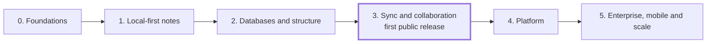

# Roadmap

Nether ships in six phases. Each one ends with a usable app and a gate, a
test that must pass before the next phase starts. Phase numbers match the
Phase column of the [requirements](requirements.md). Phases have no fixed
dates; the maintainer sets them after Phase 0.

| Phase | Scope | Gate |
| --- | --- | --- |
| 0. Foundations | First ADRs, monorepo scaffold, CI, license setup, core data model, 50,000-note test vault | CI is green, including a server run with every enterprise feature off |
| 1. Local-first notes (the Obsidian core) | Vault on disk, block and Markdown editor, links, backlinks, tags, search, templates, export, desktop app | A 50,000-note vault edits offline within the [performance targets](requirements.md#non-functional-requirements) |
| 2. Databases and structure (the Notion core) | Databases, six views, relations, rollups, formulas, synced blocks, graph view, themes, importers | An Obsidian vault and a Notion export import with no lost text |
| 3. Self-hosted sync and collaboration (first public release) | Server, end-to-end encrypted sync, history, co-editing, comments, permissions, web app, canvas, backups | `docker compose up` works; two users co-edit offline and online with no lost edits |
| 4. Platform | Plugin API and sandbox, bring-your-own AI, share links, web publishing, REST API, web clipper, automations | Third-party plugins run sandboxed; a published site loads on a custom domain |
| 5. Enterprise, mobile and scale | Free enterprise features (SSO, SCIM, audit logs, data policies, high availability), Helm chart, mobile apps, integrations | A self-hosted install runs air-gapped with SSO and audit logs on, and no license key |

Phase 3 is the first public release, because sync and self-hosting are
what set Nether apart from both Notion and Obsidian.

## How a phase runs

- One phase at a time, and inside a phase one feature at a time. Each
  feature is one branch and one pull request, whose description starts
  with a plan: the requirement, the design, the files it touches and how
  it is tested.
- Significant decisions become [Architecture Decision Records](adr/).
- At the end of each phase a short report says what shipped, what was
  deferred, the known issues, and the plan for the next phase.

## Phase 0: Foundations

Done on 2026-10-30; the [report](reports/phase-0.md) says what shipped,
what was deferred and the plan for Phase 1.

- [x] ADR 0001: one license for the whole repository, and the DCO for contributions
- [x] ADR 0002: the editor library, with a spike comparing Markdown round trips
- [x] ADR 0003: the CRDT and sync approach, and how Markdown files on disk stay in step with it
- [x] ADR 0004: the desktop app on MyGO
- [x] The monorepo: pnpm, Turborepo, strict TypeScript, ESLint, Prettier, Vitest, Playwright
- [x] CI: lint, types, tests, license scan, desktop and server builds, and a server run with every enterprise feature off
- [x] `LICENSE`, `README.md`, `CONTRIBUTING.md`, `SECURITY.md`, `CODE_OF_CONDUCT.md`
- [x] The core data model: note, block, property, database, view, link and workspace, with stable IDs and serialization tests
- [x] A generator of the reference 50,000-note vault for the performance tests

## Phase 1: Local-first notes

Done on 2026-10-31; the [report](reports/phase-1.md) says what shipped,
what was deferred and the plan for Phase 2.

The Obsidian core, one feature per pull request, in this order:

- [x] `packages/markdown`: Markdown to and from Nether's notes, with Obsidian's syntax and a round trip that keeps unchanged blocks byte for byte ([ADR 0006](adr/0006-markdown-file-format.md))
- [x] The vault on disk: reading, writing and watching the folder, and the local SQLite store ([ADR 0007](adr/0007-vault-folder-and-local-index.md))
- [x] `packages/editor`: the block editor with live Markdown shortcuts, the slash menu, block handle and rich blocks, embeds of images, PDFs, audio and video, and source mode (web link previews, and embeds of notes and blocks, come with links)
- [x] Yjs documents per note, kept in step with the files both ways
- [x] Links, backlinks, aliases, tags and the outline: the link index, `[[` links and aliases, heading and block links, the backlinks panel, tags, the outline, and embeds of notes and blocks (making a block link from `[[`, and updating links when a note is renamed, come with renaming in the app's interface)
- [x] The quick switcher and full-text search
- [x] Properties: typed properties above each note, kept in its Yjs document and its frontmatter
- [x] Templates and daily, weekly and monthly notes, with Obsidian's variables and settings ([ADR 0011](adr/0011-templates-and-periodic-notes.md))
- [x] The trash: restore where a note was, and deletion for good after 30 days or as set
- [x] Export: notes, folders and the vault to Markdown (ZIP), HTML and PDF ([ADR 0012](adr/0012-export-from-the-page.md)); databases to CSV come with databases in Phase 2
- [x] Renaming and moving notes, with every link to them rewritten
- [x] Folders and nested pages in the sidebar: the file tree and the page tree ([ADR 0013](adr/0013-pages-in-the-folder-beside-a-note.md))
- [x] The command palette, Ctrl/Cmd+P, and a shortcut for every action
- [x] Block links made from `[[`, writing the block's `^id` into its note
- [x] Previews of web links, fetched only when asked
- [x] The desktop packages: AppImage, deb and Flatpak on Linux, and updates that can be turned off (they start once a maintainer adds the update key)
- [x] The performance harness on the reference vault, which the gate runs ([tools/perf](../tools/perf/), [ADR 0014](adr/0014-load-a-vaults-links-lean-and-after-its-note.md))
- [x] Accessibility: every screen checked against WCAG 2.2 AA in the end-to-end tests, and the layout right to left ([ADR 0015](adr/0015-check-accessibility-and-lay-out-by-direction.md))

## Phase 2: Databases and structure

Done on 2026-10-31; the [report](reports/phase-2.md) says what shipped,
what was deferred and the plan for Phase 3.

The Notion core, one feature per pull request, in this order:

- [x] Opening a vault at a note its command line names, which the desktop app's measurements start at (carried over from Phase 1)
- [x] `packages/database`: a database as a note with a schema, its rows as notes with properties, and how both are stored as Markdown and frontmatter ([ADR 0018](adr/0018-a-database-is-a-note-with-an-obsidian-base-beside-it.md))
- [x] The table view, with each view's filters, sorts, grouping and visible properties
- [x] The Obsidian base beside each database, written from its schema, with Obsidian's edits read back
- [x] The board, list and gallery views
- [x] The calendar and timeline views
- [x] Relations between databases, both ways, and rollups ([ADR 0019](adr/0019-relations-are-links-both-ways-and-rollups-are-worked-out.md))
- [x] Formulas: a documented, sandboxed expression language ([ADR 0020](adr/0020-formulas-in-a-language-nether-reads-and-runs-itself.md))
- [x] Query blocks: a live table or list of the notes a folder, tag or property finds ([ADR 0021](adr/0021-query-blocks-are-obsidian-bases-in-a-code-block.md))
- [x] Databases exported to CSV ([ADR 0022](adr/0022-a-database-exports-to-csv-as-its-view-shows-it.md))
- [x] Synced blocks: one block embedded in several notes, the same everywhere ([ADR 0023](adr/0023-synced-blocks-are-block-embeds-edited-in-place.md))
- [x] Unlinked mentions, each made a link in one click ([ADR 0024](adr/0024-unlinked-mentions-found-by-the-index-and-linked-where-written.md))
- [x] The graph view, global and local, filtered by tag, folder and property, smooth at 10,000 notes ([ADR 0025](adr/0025-graph-view-with-sigma-and-forceatlas2-in-a-worker.md))
- [x] Themes and CSS snippets ([ADR 0026](adr/0026-themes-and-snippets-are-css-files-of-the-vault.md))
- [x] Importers: Obsidian vaults, plain Markdown and CSV ([ADR 0027](adr/0027-imports-are-plans-made-from-sources-read-only.md))
- [x] Importers: Notion exports ([ADR 0028](adr/0028-a-notion-export-becomes-pages-and-databases-without-ids.md))
- [x] Importers: Logseq graphs ([ADR 0029](adr/0029-a-logseq-graph-keeps-its-folders-and-is-written-as-obsidian-writes.md))
- [x] Importers: HTML ([ADR 0030](adr/0030-web-pages-import-through-the-syntax-tree-tools.md))

## Phase 3: Self-hosted sync and collaboration

Done on 2026-11-15; the [report](reports/phase-3.md) says what shipped,
what was deferred and the plan for Phase 4.

The first public release, one feature per pull request, in this order:

- [x] Headroom in the desktop app's memory: find what Phase 2 added to it at idle, before sync adds its own. Phase 2's code added about 5 MB, now 2.5 MB with the database, query and dialog code loaded when used; the rest of the rise was the machine, where the Phase 1 build itself now idles at 287 MB. The page's renderer, 208 MB of 291, is where more must come from.
- [x] The server's data model in PostgreSQL, with migrations that run on start, and the first-run setup that makes the admin account ([ADR 0031](adr/0031-the-server-keeps-its-data-in-postgresql-and-is-set-up-with-a-code-from-its-log.md)).
- [x] Accounts: email and password with argon2id, magic links and OIDC, with rate limits. Sessions and invitations ([ADR 0032](adr/0032-sessions-are-bearer-tokens-and-accounts-come-by-invitation.md)), a code by email whose link comes with the web app ([ADR 0033](adr/0033-sign-in-by-email-with-a-code-and-the-link-with-the-web-app.md)), and OIDC ([ADR 0034](adr/0034-sign-in-with-openid-connect-through-the-server-and-back-to-the-app.md)).
- [x] Sync: the Hocuspocus server, Yjs updates kept in PostgreSQL, and the desktop app's provider with its offline queue, so a vault syncs between devices with no conflict dialogs for text. The server ([ADR 0035](adr/0035-the-server-syncs-through-hocuspocus-beside-its-api-and-numbers-each-store.md)), signing in from the desktop app ([ADR 0036](adr/0036-the-desktop-app-reaches-servers-through-go-and-keeps-tokens-in-the-keychain.md)), and the vault document and engine ([ADR 0037](adr/0037-a-vault-syncs-through-a-document-of-its-paths-and-its-notes-documents.md)).
- [x] End-to-end encryption, per vault, with libsodium and a recovery phrase: keys sealed to each member, updates relayed unread, and the phrase that unlocks a new device ([ADR 0038](adr/0038-encrypted-workspaces-seal-a-key-to-each-member-and-relay-updates-the-server-cannot-read.md)).
- [x] Attachments on disk or in S3-compatible storage, deduplicated by hash: the server's store ([ADR 0039](adr/0039-attachments-are-kept-by-their-hash-on-disk-or-in-an-s3-bucket.md)), and their sync, encrypted for an encrypted workspace ([ADR 0040](adr/0040-attachments-sync-by-path-and-hash-in-the-vault-document.md)).
- [x] Version history with a diff, and its retention: each computer's versions and, for workspaces the server can read, the server's, kept as long as the admin says ([ADR 0041](adr/0041-a-notes-history-is-its-earlier-texts-kept-before-each-spell-of-editing.md)).
- [x] Workspaces, teamspaces and private spaces; roles and page permissions inherited down the page tree; guests: members and invitation links (#69), sync units for spaces, shared pages and page guests on the server (#70, #71, #73), in the sync engine (#72) and in the desktop app ([ADR 0042](adr/0042-spaces-and-shared-pages-are-sync-units-each-with-its-own-vault-document.md)).
- [x] Real-time co-editing with live cursors: notes open in the editor sync live, with the others' carets and selections ([ADR 0043](adr/0043-a-note-open-in-the-editor-syncs-live-with-awareness-for-carets.md)).
- [x] Comments and threads; mentions and notifications, by email through the admin's SMTP: comments in a document beside each note, synced with it (#76) and shown beside it (#77) ([ADR 0044](adr/0044-a-notes-comments-are-a-document-of-their-own-beside-it.md)); mentions named by the commenting client, which the server tells those who may open the note of (#78) ([ADR 0045](adr/0045-mentions-are-named-by-the-commenting-client-and-the-server-tells-those-who-may-open-the-note.md)).
- [x] The web app, served by the server, installable as a PWA, with its content security policy, its sessions in a cookie with a CSRF defence, and the link to sign in by email ([ADR 0053](adr/0053-the-web-app-is-the-desktop-page-in-the-browser-signed-in-by-a-cookie.md)): sessions in a cookie (#107), a vault's files in the browser's private file system (#109), the `web` backend with the index in SQLite's WebAssembly build and the account's workspaces as its vaults (#111), imports (#112), the page served by the server with its policy, manifest and service worker (#113), and end-to-end tests against a real server.
- [x] Workspace search on the server, by permission: PostgreSQL full text over what the server can read, indexed as notes are stored, and only the units an account opens ([ADR 0050](adr/0050-the-server-searches-what-it-can-read-indexed-as-notes-are-stored.md)).
- [x] The canvas, in the JSON Canvas format: `.canvas` files read and written as Obsidian keeps them, opened in tabs, edited by pointer and keyboard, with text, note, image, link and group cards ([ADR 0051](adr/0051-canvases-are-json-canvas-files-drawn-with-the-page-s-own-elements.md)).
- [x] Task assignment: the person property, and "assigned to me": names in person properties, offered as they are typed, and every row and note assigned to the name this device goes by, by database.
- [x] Backups to disk or S3, with the restore tested in CI; migrations safe across versions: scheduled backups of the database and attachments in one file, restored into an empty database at their schema and migrated on, and the restore run in CI as documented ([ADR 0052](adr/0052-backups-are-the-server-s-own-files-restored-at-their-schema-then-migrated.md)).
- [x] `docker compose up` with PostgreSQL, Redis and storage: the server's image with the web app, PostgreSQL 18, Valkey for the rate limits and volumes for the files, checked in CI from setup to a restore on a new install ([ADR 0054](adr/0054-docker-compose-starts-the-server-with-postgresql-valkey-and-volumes.md)).

## Phase 4: Platform

Done on 2026-11-17; the [report](reports/phase-4.md) says what shipped,
what was deferred and the plan for Phase 5.

One feature per pull request, in this order:

- [x] Headroom in the desktop app's memory, before plugins add their own: on 50,000 notes the page's renderer holds 209 MB of 291, its JavaScript heap 67 MB, and the vault's link index 31 MB of that. 10 MB of the heap was copies of the same link targets, tags, headings and property values, now shared as the links load, and the app idles at 287 MB, against 292 MB before. The process gave back about half of what the heap freed; more can come from the rest, and from the headings and the path index the page holds, about 6 MB each.
- [x] The plugin API: a versioned TypeScript SDK, `@nether/plugin-api`, under MIT ([ADR 0055](adr/0055-plugins-declare-what-they-add-and-reach-the-app-only-by-messages.md)), for commands, code blocks, block types and slash entries, sidebar and note panels, settings tabs, views, database layouts ([ADR 0056](adr/0056-a-plugins-database-layout-is-named-for-it-and-a-base-shows-it-as-a-table.md)) and property types ([ADR 0057](adr/0057-a-plugins-property-type-stores-as-one-of-the-apps-which-shows-without-it.md)). Nether's own Mermaid diagrams, query blocks, tags, assigned tasks, outline, backlinks, canvas, graph and five of its six layouts are built-in plugins on it, which the settings' Plugins tab turns on and off; each move was measured at no cost in idle memory. Only built-in plugins run until the sandbox.
- [x] The plugin sandbox: permissions declared and approved at install, untrusted plugins run isolated. A plugin from a vault's folder runs in a worker inside a sandboxed frame, approved on each device for its code as it is, with commands, code blocks and settings, and what it draws cleaned ([ADR 0058](adr/0058-a-plugin-from-a-vault-runs-in-a-sandboxed-frame-with-what-this-device-approved.md)); its views drawn in its worker and shown cleaned in the page ([ADR 0063](adr/0063-a-vault-plugins-views-draw-in-its-worker-and-the-page-shows-them-cleaned.md)); and the vault's notes read and written through the app, as far as it asked, outside hidden folders ([ADR 0064](adr/0064-a-plugin-reads-and-writes-notes-through-the-app-as-far-as-it-asked.md)).
- [x] The plugin and theme directory, a GitHub-backed index browsable in the app: `registry/index.json` in this repository, of plugins and themes pinned by commit and hash, browsed and installed from the Plugins and Appearance tabs ([ADR 0065](adr/0065-the-directory-is-an-index-in-the-repository-of-files-pinned-by-commit-and-hash.md)).
- [x] Share links with view, comment or edit access, an expiry and a password. A link opens a page shared on its own, with its subpages, to anyone with one, in the web app: to read, to comment on, or to edit live beside the others, under a name the visitor gives ([ADR 0071](adr/0071-a-share-link-opens-one-shared-page-to-anyone-with-it-through-the-web-app.md)). A visitor writes only what their link's level lets them, and never which pages there are.
- [x] Publishing a note or a folder as a site the server serves, on a custom domain. A page with its subpages, or a folder, published from the Share dialog as a site at the server's `/p/<name>/`, drawn as HTML with no script from the notes as they are now, those its publisher has full access to, with links only between its pages and its images by hash, under a policy that runs nothing; an admin turns publishing off for a workspace, and an encrypted one publishes nothing ([ADR 0076](adr/0076-a-published-site-is-a-note-or-a-folder-drawn-by-the-server-as-it-is-now-linking-only-to-its-own-pages.md)). A site opens on a custom domain its TXT record proves, the last to prove it holding it, with Caddy's on-demand TLS asking the server which domains are held; each page has its description, canonical address and Open Graph card, and each site its sitemap and robots.txt, with `noindex` for a page or a whole site ([ADR 0077](adr/0077-a-site-holds-a-custom-domain-its-dns-proves-and-tells-search-engines-what-each-page-is.md)). The phase gate's test loads a site on a custom domain in Chromium.
- [x] The public REST API with tokens, and webhooks. Personal access tokens, read or write, for one workspace or all, and `/api/v1`, which reads notes as Markdown, databases and their rows, and search, by the permissions sync uses ([ADR 0059](adr/0059-the-public-api-takes-tokens-that-act-as-their-account-and-gives-notes-as-markdown.md)); and writes notes and database rows through their documents, live in open editors, with `If-Match` against lost edits. Webhooks tell of notes made, changed and deleted, a burst as one event, signed, retried, and sent only to public addresses unless the admin allows others ([ADR 0060](adr/0060-webhooks-tell-of-notes-made-changed-and-removed-signed-and-sent-to-public-addresses.md)). The app makes and revokes tokens from Servers and signing in, and a Workspace webhooks dialog manages a workspace's webhooks.
- [x] AI, bring your own: provider settings, the off switch, writing assist, asking your notes, building with AI, and semantic search. In the desktop app, providers set up in the settings, any OpenAI-compatible endpoint or Anthropic, each key in the system's keychain, with none for an encrypted workspace's vault until one is chosen; nothing of AI shows until a vault has one, and a workspace's owners and admins turn it off for everyone ([ADR 0068](adr/0068-ai-comes-from-the-users-own-provider-reached-from-their-device.md)); and writing assist on the selection, streamed into a preview and put in as one edit ([ADR 0069](adr/0069-writing-assist-streams-into-a-preview-and-goes-in-as-one-edit.md)). In the web app, providers kept on its server, the account's own and those its admin sets for everyone, each key sealed with the admin's `NETHER_SECRET_KEY`, and requests sent through the server's relay, which enforces the workspace's switch, refuses encrypted workspaces, and reaches only public addresses, or the admin's network where `NETHER_AI_PRIVATE` allows ([ADR 0070](adr/0070-the-web-apps-ai-goes-through-its-server-which-seals-the-keys-and-reaches-only-what-it-may.md)). Search by meaning in the desktop app: a vault's notes embedded as passages by the embedding model chosen in the AI tab, their vectors kept small in the vault's index, and the search panel's search by meaning on Enter ([ADR 0074](adr/0074-search-by-meaning-keeps-passages-vectors-on-the-device-and-loads-them-only-to-search.md)). Asking your notes, in the sidebar's Ask tab: passages of the notes the vault's search finds by the question's words, and by meaning once that is on, sent with the question, the answer's citations links to their passages and any other marked unverified ([ADR 0075](adr/0075-asking-your-notes-answers-from-passages-the-vaults-search-finds-each-citation-checked.md)). Building with AI, from the File menu: a database, a template or a project plan from a description, the model's JSON reply checked against the app's own types and refused with the reason, then made as an import plan the user previews note by note before anything is written ([ADR 0078](adr/0078-building-with-ai-reads-a-checked-json-reply-into-an-import-plan-the-user-previews.md)).
- [x] Buttons and automations. Buttons are `meta-bind-button` blocks, as Obsidian's Meta Bind plugin writes them, which run commands of the app and its plugins, asking first, make notes from templates, set properties and open links, and run no code. Database triggers are rules in a database's schema, `when` a row's property becomes a value `set` others, edited in its settings, which run on the device that made the change, once, for the app's own changes, and run no trigger for what they set ([ADR 0072](adr/0072-buttons-are-meta-bind-button-blocks-and-triggers-are-schema-rules-run-where-the-change-is-made.md)). Both are the built-in Buttons and triggers plugin's.
- [x] PDF annotation, with highlights as linkable blocks. PDFs open in a view of pdf.js, a built-in plugin's, where words selected or found are highlighted and commented on, each highlight a callout in a note that links to its passage as Obsidian links to one, and links to a page, a passage or a highlight open the PDF there ([ADR 0061](adr/0061-pdfs-show-through-pdf-js-and-a-highlight-is-a-callout-that-links-to-its-passage.md)). Every note's link to a passage shows on the PDF too, as Obsidian's Copy as quote and PDF++ write them, in PDF++'s colors, which highlights take as well, and the PDF's own outline and links work ([ADR 0062](adr/0062-every-link-to-a-passage-shows-on-the-pdf-in-pdf-plus-plus-colors.md)). PDFs embedded in notes are drawn by pdf.js once on screen, on every system, a passage or a box alone when the link names one, and a highlight's embed shows its passage; an area of a page is highlighted as PDF++ writes a box ([ADR 0067](adr/0067-pdf-embeds-draw-with-pdf-js-when-on-screen-and-an-area-is-pdf-plus-plus-rect.md)).
- [x] The web clipper, for Chrome and Firefox: `apps/clipper`, a Manifest V3 extension whose button saves the selection, or the page's article through Readability, as Markdown the importer writes, to a new note, a note it is added to with `If-Match`, or a database row, through the REST API with a write token, reaching the person's own server alone ([ADR 0066](adr/0066-the-web-clipper-is-a-manifest-v3-extension-that-sends-clips-to-the-users-own-server-alone.md)). Publishing it to the Chrome Web Store and Firefox Add-ons waits on the maintainer's accounts.

## Phase 5: Enterprise, mobile and scale

Every enterprise feature is free and open source, in `enterprise/`, and an
admin turns each on or off, with no license key, seat limit or phone-home.
One feature per pull request, in this order:

- [ ] Headroom in opening the app: find what the start does before the last note shows, with 120 ms of margin left at the end of Phase 4, before Phase 5 adds its own.
- [x] The enterprise switch and the admin console: each enterprise feature on or off in the console or by environment variable, and usage, workspaces and security settings in one place. Every image has every module, each off until an instance admin turns it on in the console at `/admin` or the environment pins it, at once and with no restart; the Features page and the Usage page ([ADR 0079](adr/0079-enterprise-features-are-in-every-image-off-and-switched-in-the-console-or-pinned-by-the-environment.md)); the Workspaces page, every workspace with its owners, members and size, and its members' roles set by an instance admin, keeping an owner ([ADR 0083](adr/0083-the-console-lists-every-workspace-and-an-instance-admin-may-set-its-members-roles.md)); and the Security page, the sessions' lengths, the sign-in limits and email codes, each pinned by its variable or set in the console ([ADR 0084](adr/0084-the-consoles-security-page-sets-session-lengths-sign-in-limits-and-email-codes-unless-the-environment-does.md)).
- [ ] Single sign-on: SAML 2.0 and enforced OpenID Connect, tested against Keycloak, Okta and Microsoft Entra ID. Providers first: the console's Single sign-on page adds SAML providers, from their metadata, and OpenID Connect ones, each trusted for the email domains it is given; SAML answers are checked by node-saml, for a request the server made, once, signed, for this address, and encrypted when the provider is told to; a first sign-in at a provider's domains makes or links an account, and CI signs in through Keycloak both ways ([ADR 0080](adr/0080-single-sign-on-binds-saml-and-oidc-providers-to-email-domains-and-enforcement-refuses-other-ways-in.md)). Enforcement comes next: other ways in refused for the accounts single sign-on covers.
- [ ] Audit logs: every sign-in, permission change, share, export and deletion, searchable, and sent to a SIEM by syslog or webhook. The server's routes tell of their events through a hook the `audit` module listens to, recording each in the transaction of its change as the next event of an append-only log chained by hashes, kept as long as an admin says, checked and searched in the console ([ADR 0081](adr/0081-audit-events-come-from-a-hook-the-server-emits-kept-in-a-chained-append-only-log-and-sent-to-a-siem.md)); sending them to a SIEM, and the apps' own exports, come next.
- [ ] SCIM and LDAP: users and groups provisioned and deprovisioned.
- [ ] Advanced permissions: custom roles, group-based access and domain-restricted sharing.
- [ ] Data policies: retention rules, legal hold, and public sharing and export restricted per workspace.
- [x] Private AI endpoint enforcement: an admin locks AI to an approved internal endpoint for the whole organization. An instance admin lists the approved addresses in the console, or pins them with `NETHER_AI_ENDPOINTS`; while the `policies` feature is on, the relay neither keeps nor uses a provider elsewhere, and the apps, told in `/api/me`, use only a provider at or under one, asking again before each request ([ADR 0086](adr/0086-ai-is-locked-to-the-endpoints-an-instance-admin-approves-in-the-apps-and-the-relay.md)).
- [ ] High availability and the Helm chart: several server nodes with documented failover and zero-downtime upgrades, the sync service scaled out. A workspace's stores are numbered in the order they commit, and the encrypted relay reads its updates in that order on each node, the bus between nodes only a hint ([ADR 0082](adr/0082-several-nodes-share-sync-through-valkey-take-their-order-from-postgresql-and-roll-out-one-at-a-time.md)). Stores merge with what another node stored since; the API's turns are a lock every node shares; hourly work runs once across the nodes, claimed in the database; and each node writes a heartbeat the console lists. The bus over Valkey, upgrades and the Helm chart come next.
- [ ] The mobile apps, for iOS and Android: offline editing, quick capture and the share sheet.
- [ ] Integrations as plugins: GitHub, Slack, and Google Drive and Calendar through CalDAV and ICS first, with the admin's own OAuth credentials.

The gate: a self-hosted install runs air-gapped, with single sign-on and
audit logs on, and no license key.

